<a href="https://jettnguyen.github.io/">
  <picture>
    <source media="(prefers-color-scheme: dark)" srcset="./assets/banner-dark.svg" />
    
  </picture>
</a>

  <picture>
    <source media="(prefers-color-scheme: dark)" srcset="https://readme-typing-svg.demolab.com?font=Inter&weight=600&size=24&duration=2000&pause=1500&color=FFFFFF&center=true&vCenter=true&width=600&lines=Co-Founder+%26+CTO+%40+Otian+AI+%F0%9F%A4%96;AI+Engineer+%F0%9F%A7%A0;B.S.+CS+%2B+PR+%40+University+of+Florida+%F0%9F%90%8A;Prev+SWE+Intern+%40+MARA+%F0%9F%92%BC;Shipping+apps+to+the+App+Store+%F0%9F%93%B1;Music+Producer+%F0%9F%8E%B9" />
    
  </picture>

<table width="100%">
  <tr>
    <td width="180" align="center" valign="middle">
      
    </td>
    <td align="center" valign="middle">
      
      
      
      
      
      
    </td>
  </tr>
</table>

## About Me 📝

<table width="100%">
  <tr>
    <td width="53%" valign="top">
      <strong>Quick Facts:</strong>
      <ul>
        <li>🔭 Open to AI engineering roles</li>
        <li>🤖 Co-Founder & CTO, <a href="https://otianai.com">Otian AI</a></li>
        <li>🎓 B.S. Computer Science, University of Florida (May 2026)</li>
        <li>📢 Minor in Public Relations</li>
        <li>💼 Prev Software Engineer Intern, MARA</li>
        <li>🎹 Music Producer (Rap, R&B, Electronic, Indie, & more)</li>
        <li>🎮 Played Rocket League for Gator Esports</li>
        <li>🛍️ eCommerce Seller (Vintage Clothing & Collectibles)</li>
        <li>📍 Gainesville, FL / Saint Petersburg, FL</li>
      </ul>
    </td>
    <td width="47%" valign="top">
      <em>I graduated from UF in May 2026 with a B.S. in Computer Science and a minor in Public Relations, and I'm looking for work where those two overlap: building AI agents, and being able to explain why people can trust them. At Otian AI, which I co-founded with Jack Raney, I lead engineering on Archie, an AI agent that runs on your own computer. It can draft an email or a calendar change, but it can't send or make it until a person says yes, and the code makes sure of that. Outside of Otian, I build my own apps, run agents for my own work, and produce music.</em>
    </td>
  </tr>
</table>

## Featured Projects 🚀

<!-- Skill icon lists write commas as %2C. GitHub splits image addresses inside <source srcset> at commas, which cuts the list to its first icon. -->

<table width="100%">
<tr>
<td width="50%" align="center" valign="top">
 
<a href="https://otianai.com/">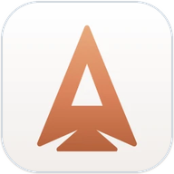</a>
<h3><a href="https://otianai.com/">Archie</a></h3>
<b>Otian AI</b> · Mac, Windows & iPhone · Beta

A personal AI agent that runs on your own computer and answers you from the chat apps you already use. It can draft the email or the calendar change, but nothing goes out until you say yes. I lead engineering. <a href="https://jettnguyen.github.io/#project/archie">Read&nbsp;more&nbsp;→</a>

<picture>
<source media="(prefers-color-scheme: dark)" srcset="https://skillicons.dev/icons?i=react%2Cts%2Crust%2Ctauri%2Ctailwind%2Csqlite%2Cfirebase&theme=dark" />

</picture>
  

  
</td>
<td width="50%" align="center" valign="top">
 

<h3><a href="https://jettnguyen.github.io/#project/hudson">Hudson</a></h3>
<b>Otian AI</b> · Back office agent

The agent that runs Otian's back office for my co-founder and me: three inboxes, two calendars, leads, the blog, and company social. Nothing leaves the company until one of us taps send. <a href="https://jettnguyen.github.io/#project/hudson">Read&nbsp;more&nbsp;→</a>

<picture>
<source media="(prefers-color-scheme: dark)" srcset="https://skillicons.dev/icons?i=py%2Cnodejs%2Cfirebase%2Cgmail%2Creact&theme=dark" />

</picture>
  
</td>
</tr>
<tr>
<td width="50%" align="center" valign="top">
 

<h3><a href="https://studioflow-music.vercel.app/">Studioflow</a></h3>
<b>Solo</b> · Web & iPhone

Music collaboration for SyWavy and me: songs, versions, files, and notes in one place, plus a content side where we plan, caption, and track every post with Sable, the agent on my laptop. <a href="https://jettnguyen.github.io/#project/studioflow">Read&nbsp;more&nbsp;→</a>

<picture>
<source media="(prefers-color-scheme: dark)" srcset="https://skillicons.dev/icons?i=react%2Cts%2Cvite%2Cswift%2Cexpress%2Cprisma%2Cpostgres%2Caws&theme=dark" />

</picture>
  

  
</td>
<td width="50%" align="center" valign="top">
 
<a href="https://nightlink.dev/">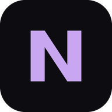</a>
<h3><a href="https://nightlink.dev/">NightLink</a></h3>
<b>Solo</b> · iPhone & web

A dream journal and social network. Log a dream by voice or text, get an AI title and summary, and choose who gets to see each one. <a href="https://jettnguyen.github.io/#project/nightlink">Read&nbsp;more&nbsp;→</a>

<picture>
<source media="(prefers-color-scheme: dark)" srcset="https://skillicons.dev/icons?i=react%2Cvite%2Csupabase%2Cvercel%2Cgithubactions&theme=dark" />

</picture>
  

  
</td>
</tr>
<tr>
<td width="50%" align="center" valign="top">
 
<a href="https://tempify.me/">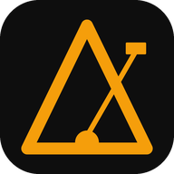</a>
<h3><a href="https://tempify.me/">Tempify</a></h3>
<b>Solo</b> · iPhone & web

Five daily music games for people who know their songs. An agent writes each day's puzzles two weeks ahead and drops any fact it can't check. <a href="https://jettnguyen.github.io/#project/tempify">Read&nbsp;more&nbsp;→</a>

<picture>
<source media="(prefers-color-scheme: dark)" srcset="https://skillicons.dev/icons?i=react%2Cvite%2Ctailwind%2Csupabase%2Cworkers%2Cpy&theme=dark" />

</picture>
  

  
</td>
<td width="50%" align="center" valign="top">
 
<a href="https://jettnguyen.github.io/Sideline/">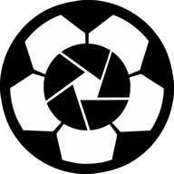</a>
<h3><a href="https://jettnguyen.github.io/Sideline/">Sideline</a></h3>
<b>Senior project</b> · Frontend lead on a team of four

A video app for youth soccer families to upload, sort, share, and tag game clips, designed around one-handed phone use on the sidelines. <a href="https://jettnguyen.github.io/#project/sideline">Read&nbsp;more&nbsp;→</a>

<picture>
<source media="(prefers-color-scheme: dark)" srcset="https://skillicons.dev/icons?i=react%2Cnodejs%2Cexpress%2Cmongodb%2Caws&theme=dark" />

</picture>
  

  
</td>
</tr>
</table>

### More Things I've Built

<table width="100%">
<tr>
<td width="25%" align="center" valign="top">
<a href="https://sywavy.com/">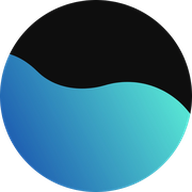</a> 
<b><a href="https://sywavy.com/">SyWavy.com</a></b> 
The website for SyWavy, the artist I produce for
</td>
<td width="25%" align="center" valign="top">
<a href="https://github.com/JettNguyen/Splitsy">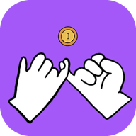</a> 
<b><a href="https://github.com/JettNguyen/Splitsy">Splitsy</a></b> 
Scan a receipt and split the bill with friends
</td>
<td width="25%" align="center" valign="top">
 
<b><a href="https://jettnguyen.github.io/Stackd/">Stackd</a></b> 
Flashcards for UF students, with decks made by AI
</td>
<td width="25%" align="center" valign="top">
<a href="https://jettnguyen.github.io/Nexel/">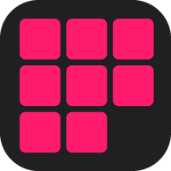</a> 
<b><a href="https://jettnguyen.github.io/Nexel/">Nexel</a></b> 
A block puzzle with eight solvers to watch
</td>
</tr>
<tr>
<td width="25%" align="center" valign="top">
<a href="https://jettnguyen.github.io/Slide15/">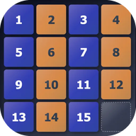</a> 
<b><a href="https://jettnguyen.github.io/Slide15/">Slide15</a></b> 
A 15 puzzle with a solver that finds the fewest moves
</td>
<td width="25%" align="center" valign="top">
<a href="https://github.com/JettNguyen/Frequify">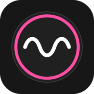</a> 
<b><a href="https://github.com/JettNguyen/Frequify">Frequify</a></b> 
Audio mastering for Windows that works offline
</td>
<td width="25%" align="center" valign="top">
<a href="https://github.com/JettNguyen/ProducerFingerprint">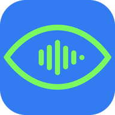</a> 
<b><a href="https://github.com/JettNguyen/ProducerFingerprint">ProducerFingerprint</a></b> 
Measures what makes a producer's sound
</td>
<td width="25%" align="center" valign="top">
<a href="https://jettnguyen.github.io/GridironGuru/">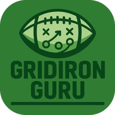</a> 
<b><a href="https://jettnguyen.github.io/GridironGuru/">Gridiron Guru</a></b> 
NFL play picks from 538,745 real plays
</td>
</tr>
</table>

<a href="https://jettnguyen.github.io/#work"><b>See every project on my site →</b></a>

## Skills 🛠️

  <b>Languages</b>  
  <picture>
    <source media="(prefers-color-scheme: dark)" srcset="https://skillicons.dev/icons?i=py%2Cjs%2Cts%2Ccpp%2Cjava%2Ccs%2Cswift%2Crust%2Chtml%2Ccss%2Cphp&theme=dark" />
    
  </picture>

  <b>Frameworks & Libraries</b>  
  <picture>
    <source media="(prefers-color-scheme: dark)" srcset="https://skillicons.dev/icons?i=react%2Cnextjs%2Cnodejs%2Cexpress%2Cvite%2Ctailwind%2Cthreejs%2Cprisma%2Ctauri%2Celectron%2Cdotnet%2Cfastapi&theme=dark" />
    
  </picture>

  <b>AI Models</b>  
  <picture>
    <source media="(prefers-color-scheme: dark)" srcset="./assets/skills/ai-models-dark.svg" />
    
  </picture>

  <b>Agents & AI Coding</b>  
  <picture>
    <source media="(prefers-color-scheme: dark)" srcset="./assets/skills/ai-agents-dark.svg" />
    
  </picture>

  <b>Data & Cloud</b>  
  <picture>
    <source media="(prefers-color-scheme: dark)" srcset="https://skillicons.dev/icons?i=supabase%2Cpostgres%2Cmongodb%2Csqlite%2Cfirebase%2Caws%2Cgcp%2Ccloudflare%2Cvercel%2Cnetlify%2Cgithubactions&theme=dark" />
    
  </picture>

  <b>Shipping Apps</b>  
  <picture>
    <source media="(prefers-color-scheme: dark)" srcset="./assets/skills/shipping-dark.svg" />
    
  </picture>

  <b>Tools & Design</b>  
  <picture>
    <source media="(prefers-color-scheme: dark)" srcset="https://skillicons.dev/icons?i=git%2Cgithub%2Cvscode%2Cpycharm%2Cclion%2Cfigma%2Cps%2Cpr%2Carduino&theme=dark" />
    
  </picture>

  <b>Design & UX</b>  
  <picture>
    <source media="(prefers-color-scheme: dark)" srcset="./assets/skills/design-dark.svg" />
    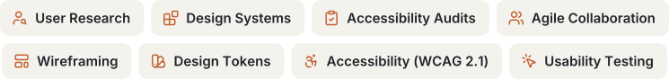
  </picture>

<b>Everything else I use</b>

 

  
  
  
  
  
  
  
  
  
  
  
  
  
  
  
  
  
  
  
  
  
  
  
  
  
  
  
  

## GitHub Stats 📊

  <picture>
    <source media="(prefers-color-scheme: dark)" srcset="https://github-profile-summary-cards.vercel.app/api/cards/profile-details?username=JettNguyen&theme=github_dark" />
    
  </picture>

<table width="100%">
  <tr>
    <td width="50%" align="center">
      <picture>
        <source media="(prefers-color-scheme: dark)" srcset="https://streak-stats.demolab.com/?user=JettNguyen&theme=github-dark-blue&hide_border=true" />
        
      </picture>
    </td>
    <td width="50%" align="center">
      <picture>
        <source media="(prefers-color-scheme: dark)" srcset="https://github-readme-stats-fast.vercel.app/api/top-langs?username=JettNguyen&layout=compact&theme=github_dark&hide_border=true" />
        
      </picture>
    </td>
  </tr>
</table>

## Music & Interests 🎧

<table width="100%">
  <tr>
    <td width="50%" align="center" valign="top">
      <picture>
        <source media="(prefers-color-scheme: dark)" srcset="https://lastfm-recently-played.jeffreyca.workers.dev/svg?user=Jett2Fly&theme=dark&count=5" />
        
      </picture>
    </td>
    <td width="50%" align="center" valign="top">
      
      
       
      
      
       
      
      
      
    </td>
  </tr>
</table>

## Connect With Me 📲

  ✉️ <a href="mailto:jettuf26@gmail.com"><b>jettuf26@gmail.com</b></a> &nbsp;·&nbsp;
  💼 <a href="https://www.linkedin.com/in/jett-nguyen/"><b>LinkedIn</b></a> &nbsp;·&nbsp;
  📱 <a href="https://www.instagram.com/7jettster7/"><b>Instagram</b></a> &nbsp;·&nbsp;
  🔗 <a href="https://jett2fly.com/"><b>Jett2Fly.com</b></a>

